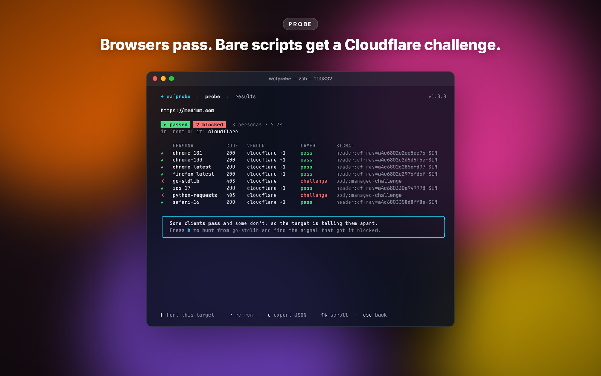
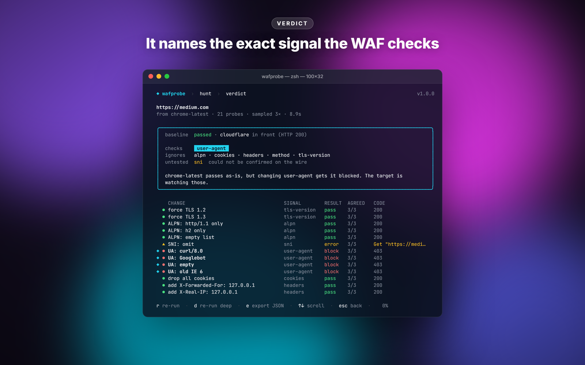
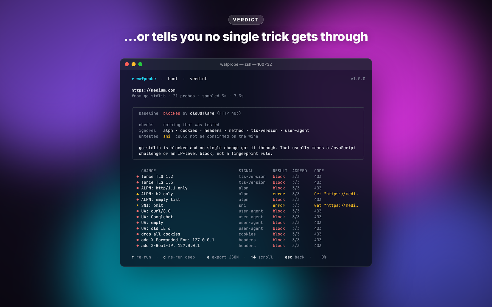

# wafprobe

Built this after spending too many evenings trying to figure out why my scraper got 403'd on one site but not another. curl-impersonate worked here, broke there. Tweaking User-Agent did nothing on one target, fixed another. Couldn't tell which fingerprint axis any given WAF actually cared about, so I was guessing. wafprobe stops the guessing.

Point it at a URL. It fires a bunch of probes that each change exactly one thing about the request — TLS version, ALPN, SNI, User-Agent, individual headers, HTTP method — and diffs the outcomes. You get back: which axes the WAF inspects, which ones it ignores, which it couldn't test, and (when something passes) a copy-paste curl line that reproduces the bypass.







<sub>Real runs against medium.com from the interactive UI (`wafprobe` with no arguments).</sub>

```
$ wafprobe hunt https://www.cloudflare.com

baseline (chrome-latest): block — cloudflare

  force TLS 1.2          tls-version    block
  ALPN: http/1.1 only    alpn           block
  SNI: omit              sni            n/a
  UA: curl/8.0           user-agent     block
  UA: Googlebot          user-agent     pass
  drop all cookies       cookies        block
  ...

╔════════════════ REVERSE-ENGINEERED ════════════════╗
║  Target checks:  user-agent                         ║
║  Target ignores: alpn, cookies, headers, tls-version║
║  Untested (unverified): sni                         ║
║  Verdict: baseline was block; 1 mutation passed.    ║
╚═════════════════════════════════════════════════════╝
```

Each cell is probed a few times and majority-voted, and each mutation is checked against the wire it actually produced — so an axis only lands in "checks" or "ignores" if it was really, reproducibly tested. A mutation the stack couldn't carry (a forced TLS version the server won't negotiate, an SNI omission the target rejects) is reported as `n/a` / **untested**, never silently counted as "ignored".

## What the personas actually are

The thing that makes this more than another header-swapper: each browser persona is browser-shaped at every layer the request touches, not just the User-Agent. Under the hood it uses [`bogdanfinn/tls-client`](https://github.com/bogdanfinn/tls-client), so a `chrome-latest` request carries real Chrome's TLS ClientHello, **HTTP/2 SETTINGS and pseudo-header order**, and an ordered browser header set — the layers an Akamai or DataDome H2 fingerprint keys on. Earlier versions sent a Chrome TLS handshake wrapped around Go's HTTP/2 stack and two headers; a decent fingerprinter saw straight through that. Now the baseline is a request an actual browser would send.

`go-stdlib` and `python-requests` are the opposite on purpose: genuine naked Go clients (real `crypto/tls` + `net/http`), so the contrast against the browser personas is a real signal, not a costume.

Browser personas pin the newest TLS preset the library ships to a User-Agent of the **same major version** — so the handshake and the UA agree instead of a current UA riding a stale ClientHello. As of this build that's Chrome 152, Firefox 148, Safari 16/iOS 17. Those track the library; `wafprobe list` shows what's registered.

## Install

```
go install github.com/NotChaosuu/wafprobe/cmd/wafprobe@latest
```

Needs Go 1.25 — an indirect dependency (`golang.org/x/net`) requires it. It's a network tool, so it's not offline-pure; the dependency tree is larger than a raw-utls build (tls-client pulls its fhttp/utls forks).

## How to use it

Run `wafprobe` with no arguments and it opens a full-screen interactive UI. Pick probe, hunt, import-har or the persona browser from the menu, type a URL and press enter; the probes land live and the verdict is one screen. From a probe result `h` starts a hunt on the same target, on a hunt verdict `c` copies the bypass `curl`, and `e` exports the JSON report. It needs a real terminal (piped or redirected, `wafprobe` prints usage instead) and is built on Bubble Tea. Everything below is also available directly as subcommands.

`probe` runs every built-in persona (Chrome / Firefox / Safari / iOS / stock Go / stock Python) in parallel and tells you which get blocked. Use this first — it's the fast "what's even here" pass:

```
wafprobe probe https://target.com
wafprobe probe --personas chrome-latest,go-stdlib https://target.com
```

`--json` also emits each persona's TLS fingerprint: the JA3 MD5, the FoxIO **JA4**, and the request's **JA4H**. JA4 sorts ciphers and extensions before hashing, so it's stable across the per-handshake extension shuffle real Chrome applies (browser personas shuffle their ClientHello order per connection too) — the JA3 hash of a randomized persona drifts run to run, the JA4 doesn't, so it's the one that matches what the WAF keys on. The two stock personas don't carry a pre-computed JA3/JA4 (their ClientHello is Go's, produced at handshake time) — their fingerprint is simply Go's default.

If something gets blocked, switch to `hunt`. It runs 21 mutation probes (66 with `--deep`), each twiddling exactly one fingerprint axis, and samples each a few times (`--repeats`, default 3):

```
wafprobe hunt https://target.com
wafprobe hunt --deep https://target.com
wafprobe hunt --exit-code https://target.com    # 2 unreachable · 3 too unstable to attribute · 1 blocked, no bypass · 0 otherwise
```

Each cell is sampled a few times and majority-voted. If the target answers the same request inconsistently — rate-limiting, IP-reputation scoring, a flaky edge — `hunt` refuses to guess: it prints **"Run unstable — no axis attribution"** rather than a verdict its own noise contradicts, and `--exit-code` returns 3. On a target like that, slow down, raise `--repeats`, or probe from a cleaner IP.

For sites with stateful JS-injected headers (Shape's `X-<id>-<letter>` family, Akamai's `_abck` cookie, Kasada's `x-kpsdk-*` tokens), you can't probe from scratch — the browser's JS sensor generates those values. But you can capture a real browser request and replay it:

```
# In Chrome DevTools → Network → "Save all as HAR with content"
wafprobe import-har -o cap.json --filter "auth/login" devtools.har
wafprobe hunt --persona-file cap.json https://api.target.com/auth/login
```

`import-har` tags any Shape or Kasada signatures it finds in the captured headers — a quick way to confirm you grabbed the right request. It reconstructs a form body from `postData.params` when the HAR has no raw text, so a login POST doesn't replay empty. Captured persona files hold the session cookie and any auth header, so they're written `0600`.

For auth endpoints (login, cart, checkout — where Shape/Kasada/PX actually fire), use POST mode:

```
wafprobe hunt --method POST \
  --body @login.json \
  --header "Content-Type: application/json" \
  --header "Origin: https://target.com" \
  --cookie "session=abc; csrf=xyz" \
  https://api.target.com/v1/auth/login
```

Proxy support: `--proxy user:pass@host:port` (URL form), `--proxy host:port:user:pass` (the IP-rotation 4-part format residential panels use), or `--proxy socks5://host:port`.

wafprobe does **not** validate the target's TLS certificate — it's inspecting how a WAF responds, not opening a secure channel, and a cert error is never a WAF signal.

`wafprobe hunt --help` for the full flag list.

## What gets detected

27 vendors. Eight of them — the bot-management heavyweights — get deep, layer-aware profiling:

- Cloudflare — and which kind: Managed Challenge (the `cf_clearance` interstitial) vs Turnstile widget. Different problems, different solutions.
- Akamai — separates Bot Manager from plain Akamai CDN. Lots of sites route through Akamai's CDN with Kasada or Shape doing the actual bot work, so `Server: AkamaiGHost` alone doesn't mean BM is on. The `_abck` cookie is read the way it's actually shaped — a `~`-delimited value whose second field is the sensor verdict (`-1` = still profiling), not a made-up state token.
- DataDome
- PerimeterX / HUMAN
- Imperva / Incapsula
- AWS WAF
- Kasada — `X-KPSDK-*` headers, the sensor script (wherever it loads from, not just `/ips.js`), 429 default block.
- Shape / F5 XC Bot Defense — pattern-matches the `X-<8char-id>-<letter>` request-header family (`X-[A-Za-z0-9]{6,12}-[A-Z][0-9]?`, two matching ids required). A lone `TS<hex>` cookie is reported as plain `f5-bigip`, not Shape, since it only proves a BIG-IP is in the path.

The other nineteen are fingerprinted from headers, cookies, and block-page markers, cross-checked against the wafw00f corpus:

- **Appliance WAFs** — F5 BIG-IP ASM, Citrix NetScaler / ADC, Fortinet FortiWeb, Barracuda, Radware AppWall, Sucuri, Wordfence, ModSecurity / OWASP CRS, Wallarm.
- **Cloud WAF / edge** — Azure Front Door + Application Gateway WAF, Vercel Security Checkpoint, Reblaze, Queue-it, plus low-confidence CDN labels for CloudFront and Fastly (which edge is in front, not that a WAF is blocking).
- **CAPTCHA / challenge widgets** — Arkose Labs (FunCaptcha), hCaptcha, Google reCAPTCHA (and Enterprise), Friendly Captcha — spotted from the embedded widget, so you know a form is gated even when the page returns 200.

Some vendors are deliberately absent: Netacea is agentless and leaves no passive fingerprint, and StackPath's CDN shut down in 2023 — wafprobe doesn't pretend to detect them.

Every detection is tagged with a layer — `pass`, `sensor` (profiling but not blocking yet), `http` (block page), `challenge` (JS interstitial), or `rate-limit` — and a confidence (`high` for a vendor-unique token, `low` for a shared CDN marker), so a `Via: cloudfront` never masquerades as a WAF verdict. When two vendors fire on one response (a CDN in front of a captcha), the primary is shown and the rest are kept in an `also` list rather than dropped. Ordinary non-2xx codes (a 404, a 405, an unauthenticated 401) are not read as blocks unless a vendor actually fires.

## Honest limits

- **The Safari / iOS personas can trip a utls bug on some ECDSA certificates.** On a small number of servers the `safari-16` / `ios-17` profiles fail utls's handshake signature check and the request comes back as `err` — not `block`, so it isn't misread as a WAF verdict, but that persona returns no result for that target. It's rare (one domain in ~140 real ones tested, example.com among them) and unrelated to a specific curve; Chrome, Firefox and the stock personas are unaffected. Because errors correctly fail closed, `probe --exit-code` can return non-zero on such a handshake error even against a site with no WAF — check the per-persona rows, not just the exit code.
- **HTTP/2 SETTINGS isn't a mutation *axis* yet.** The baseline now sends a real browser's SETTINGS and header order, so it's no longer a Go tell — but "vary the SETTINGS frame and diff" isn't a probe you can run. On the list.
- **SNI omission depends on the target.** wafprobe genuinely drops the SNI extension from the ClientHello, but many servers reject a handshake without it; when that happens the probe is reported `n/a`/untested rather than as a diff.
- **Many bot-management vendors don't fire on the homepage.** Shape, Kasada, PerimeterX usually only engage on `/login`, `/cart`, `/api/auth/*`. If `probe` says "clean" against a site you know has bot protection, point it at the auth endpoint.
- **No JS challenge solving.** wafprobe diagnoses whether you need a JS solver (FlareSolverr, headless Chrome) — it doesn't be one.

## On Windows

If your URL has `&` in it, wrap it in double quotes on cmd.exe — it treats `&` as a command separator and truncates the URL otherwise. PowerShell and POSIX shells are fine.

```
wafprobe.exe hunt "https://target.com/path?a=1&b=2"
```

## Tests

```
go test ./...
```

Per-package coverage runs from the low 30s (the terminal renderer) to ~90% (probe); the client, detector, persona and fingerprint packages are the well-covered core. The client tests assert mutations against the *wire* a test server actually received — a forced http/1.1 really downgrades the connection, a dropped header really leaves the request — because a struct-level test is exactly how a no-op mutation would slip through. `go test ./... -cover` for the current numbers.

---

License: MIT. Author: Chaosuu — t.me/chaosuudev. More tools: github.com/NotChaosuu.
